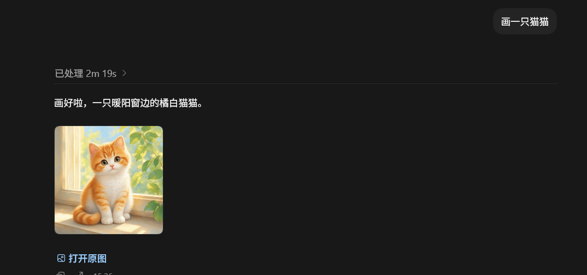

<div align="center">
  <h1>Codex GPT Image MCP</h1>
  <p>Use your own OpenAI-compatible image API from Codex with local files and inline previews.</p>
  <p>
    <a href="#中文">中文</a> · <a href="#english">English</a>
  </p>
  <p>
    
    
    
    
  </p>
</div>



## 中文

### 解决什么问题

使用 API Key 登录 Codex 桌面端时，内置图片生成工具可能没有出现在当前任务中。即使 API 服务本身支持 `gpt-image-2`，Codex 也无法直接调用、保存并内嵌展示生成结果。

本项目把 OpenAI 兼容图片接口包装成一个本地 stdio MCP 服务，并附带 Codex 插件与技能。安装后，Codex 可以像调用普通工具一样完成：

- `image_service_status`：检查配置，不返回 API Key。
- `generate_image`：文字生成图片，保存原图并返回轻量内嵌预览。
- `edit_image`：使用本地图片、多个参考图和可选蒙版进行编辑。

项目支持两条上游路径：

- **Images API**：调用 `/images/generations` 与 `/images/edits`。
- **Responses API**：调用 `/responses` 中的 `image_generation` 工具。
- **auto 模式**：优先 Images API；遇到 `404`、`405` 或 `501` 时自动改用 Responses API。它不会切换到另一个图片提供方。

这使只转发 Responses API 的网关也能提供图片能力，同时兼容标准 OpenAI Images API 和兼容服务。

### 特性

- 支持 `gpt-image-2` 生成与编辑。
- 返回本地绝对路径、`file://` URI、usage 和最多 4 张内嵌预览。
- 支持 PNG、JPEG、WebP、尺寸、质量、背景、审核级别和压缩率。
- 支持最多 10 张同提示词结果、16 张输入参考图和 PNG 蒙版。
- 默认 20 分钟超时，适合较慢的图片模型。
- API Key 只从环境变量读取，不出现在工具参数、提示词或错误信息中。
- 输入/输出路径默认限制在用户主目录；可通过允许目录扩展。
- 包含完全本地的协议测试，不消耗真实 API 配额。

### 环境要求

- Codex CLI 或 Codex 桌面端
- Node.js 20 或更高版本
- 一个支持 Images API 或 Responses `image_generation` 的 OpenAI 兼容 API

### 快速安装

```powershell
git clone https://github.com/Xuan-BOMS/codex-gpt-image-mcp.git "$HOME\plugins\gpt-image-mcp"
Set-Location "$HOME\plugins\gpt-image-mcp\server"
npm ci --omit=dev
```

#### 1. 配置 API

Windows 推荐使用交互脚本。API Key 输入不可见，并保存到当前 Windows 用户环境变量：

```powershell
powershell -ExecutionPolicy Bypass -File "$HOME\plugins\gpt-image-mcp\scripts\configure.ps1" `
  -BaseUrl "https://api.openai.com/v1" `
  -Model "gpt-image-2" `
  -ApiMode "auto"
```

macOS / Linux：

```bash
export GPT_IMAGE_API_KEY="your_api_key_here"
export GPT_IMAGE_BASE_URL="https://api.openai.com/v1"
export GPT_IMAGE_MODEL="gpt-image-2"
export GPT_IMAGE_RESPONSES_MODEL="gpt-5.6"
export GPT_IMAGE_API_MODE="auto"
```

不要把真实 Key 写入仓库、README、Codex 提示词或 `config.toml`。

#### 2. 注册 MCP

把下面内容加入 `~/.codex/config.toml`，将路径替换为本机绝对路径：

```toml
[mcp_servers.gpt-image]
command = "node"
args = ["C:\\Users\\YOUR_NAME\\plugins\\gpt-image-mcp\\server\\index.mjs"]
env_vars = [
  "GPT_IMAGE_API_KEY",
  "GPT_IMAGE_BASE_URL",
  "GPT_IMAGE_MODEL",
  "GPT_IMAGE_RESPONSES_MODEL",
  "GPT_IMAGE_API_MODE",
  "GPT_IMAGE_USER_AGENT",
  "GPT_IMAGE_OUTPUT_DIR",
  "GPT_IMAGE_ALLOWED_ROOTS",
  "GPT_IMAGE_TIMEOUT_MS",
  "OPENAI_API_KEY",
  "OPENAI_API_BASE_URL"
]
startup_timeout_sec = 20
tool_timeout_sec = 1200
```

验证注册：

```powershell
codex mcp list --json
```

输出中应出现启用的 `gpt-image`。完全退出 Codex（包括系统托盘后台进程），重新启动并新建任务，然后发送：

```text
调用 image_service_status 检查图片服务，然后画一只猫。
```

### 提示词安装

先设置好 `GPT_IMAGE_API_KEY` 和 `GPT_IMAGE_BASE_URL`，然后把下面整段提示词发送给一个拥有终端和文件编辑权限的 Codex 任务。不要把真实 API Key 粘贴进提示词。

```text
请安装并配置 https://github.com/Xuan-BOMS/codex-gpt-image-mcp ，直接执行，不要只给我命令。

要求：
1. 克隆或更新仓库到 ~/plugins/gpt-image-mcp。
2. 在 server 目录执行 npm ci --omit=dev。
3. 保留 ~/.codex/config.toml 的全部现有内容，只新增或更新 mcp_servers.gpt-image；使用仓库内 server/index.mjs 的绝对路径，并通过 env_vars 转发所有 GPT_IMAGE_* 环境变量。
4. 不要读取、打印、复制或写入我的 API Key；Key 已存在于用户环境变量中。
5. 执行 npm test，并执行 codex mcp list --json，确认 gpt-image 为 enabled。
6. 告诉我需要完全退出 Codex 后台并新建任务；不要修改其他 MCP、插件或 AGENTS.md。
```

也可以要求 Codex 走插件安装路径：克隆到 `~/plugins/gpt-image-mcp`，加入个人 marketplace，安装 `gpt-image-mcp@personal`，再用 `codex mcp list --json` 验证。仓库根目录已经包含 `.codex-plugin/plugin.json`、`.mcp.json` 和技能文件。

### 环境变量

| 变量 | 默认值 | 说明 |
| --- | --- | --- |
| `GPT_IMAGE_API_KEY` | 无 | 必需。也兼容 `OPENAI_API_KEY`。 |
| `GPT_IMAGE_BASE_URL` | OpenAI SDK 默认 | API 根地址，也兼容 `OPENAI_API_BASE_URL`。 |
| `GPT_IMAGE_MODEL` | `gpt-image-2` | 图片模型。 |
| `GPT_IMAGE_RESPONSES_MODEL` | `gpt-5.6` | Responses 后端用于调用图片工具的主模型。 |
| `GPT_IMAGE_API_MODE` | `auto` | `auto`、`images` 或 `responses`。 |
| `GPT_IMAGE_OUTPUT_DIR` | `~/.codex/generated_images/gpt-image-mcp` | 原图输出目录。 |
| `GPT_IMAGE_ALLOWED_ROOTS` | 用户主目录 | 额外允许路径；Windows 用 `;` 分隔，macOS/Linux 用 `:`。 |
| `GPT_IMAGE_TIMEOUT_MS` | `1200000` | API 超时毫秒数。 |
| `GPT_IMAGE_USER_AGENT` | OpenAI SDK 默认 | 仅用于某些会按客户端标识过滤请求的兼容网关。 |

使用 Responses 后端时，主模型 token 与图片生成可能分别计费，具体以供应商账单为准。

### 工具示例

```text
调用 image_service_status。
```

```text
用 generate_image 生成一张 1536x1024、medium 质量的电影感城市夜景，返回内嵌预览。
```

```text
用 edit_image 编辑 C:\path\photo.png，只替换天空，其他内容保持不变。
```

### 测试

```powershell
Set-Location server
npm ci
npm test
npm audit --omit=dev
```

测试会启动临时本地 API，覆盖 Images、Responses 和自动降级路径，不会访问真实图片服务。

### 常见问题

**技能出现了，但工具没有出现**

技能文件和 MCP 工具是两条独立加载链路。执行 `codex mcp list --json`，确认 `gpt-image` 存在且启用；然后完全退出 Codex 后台，重启并新建任务。旧任务不能热加载新 MCP 工具。

**Images API 返回 404**

使用 `GPT_IMAGE_API_MODE=auto`。服务会尝试 Responses `image_generation`，前提是网关支持该工具。

**兼容网关返回 403，但 Codex 文本请求正常**

某些网关会根据 `User-Agent` 过滤。只在你信任该网关时设置 `GPT_IMAGE_USER_AGENT`；不要把认证信息放进这个变量。

**请求了 1024x1024，但返回尺寸不同**

服务会把尺寸参数传给上游，但兼容供应商可能忽略它。返回文件保留上游原图，不会静默缩放。

### 安全设计

- MCP 工具参数中没有 API Key 字段。
- 错误消息会清理 API Key 和 Bearer Token。
- 默认只允许读取用户主目录内的图片。
- 输出文件使用非覆盖写入；同名时生成备用文件名。
- 内嵌预览压缩为最大 512px JPEG，原图保存在本地。

### 与 gpt-image-2-webui 的关系

本项目受 [JunWan666/gpt-image-2-webui](https://github.com/JunWan666/gpt-image-2-webui) 的 OpenAI 兼容接口、长超时、本地保存和图片编辑工作流启发。

两者面向不同使用方式：`gpt-image-2-webui` 提供完整浏览器工作台；本项目是独立实现的 stdio MCP 服务，让 Codex 在对话中直接调用图片能力。本仓库未复制其源码。

---

## English

### The problem

When Codex Desktop is authenticated with an API key, its built-in image-generation tool may be unavailable even though the configured provider supports `gpt-image-2`. Codex then has no native way to call that API, save originals, edit local images, and render a result inline.

This project exposes an OpenAI-compatible image service as a local stdio MCP server and includes Codex plugin metadata plus a reusable skill. It provides three tools:

- `image_service_status`: reports configuration without returning the API key.
- `generate_image`: generates images, saves originals, and returns compact inline previews.
- `edit_image`: edits local images with multiple references and an optional mask.

It supports the Images API, the Responses API `image_generation` tool, and an `auto` mode that falls back to Responses after `404`, `405`, or `501`. The fallback uses the same configured provider; it never silently changes providers.

### Requirements

- Codex CLI or Codex Desktop
- Node.js 20+
- An OpenAI-compatible API supporting Images or Responses image generation

### Quick start

```powershell
git clone https://github.com/Xuan-BOMS/codex-gpt-image-mcp.git "$HOME\plugins\gpt-image-mcp"
Set-Location "$HOME\plugins\gpt-image-mcp\server"
npm ci --omit=dev
```

Configure Windows user environment variables with hidden key input:

```powershell
powershell -ExecutionPolicy Bypass -File "$HOME\plugins\gpt-image-mcp\scripts\configure.ps1" `
  -BaseUrl "https://api.openai.com/v1" `
  -Model "gpt-image-2" `
  -ApiMode "auto"
```

Add the following to `~/.codex/config.toml`, replacing the server path with an absolute local path:

```toml
[mcp_servers.gpt-image]
command = "node"
args = ["C:\\Users\\YOUR_NAME\\plugins\\gpt-image-mcp\\server\\index.mjs"]
env_vars = [
  "GPT_IMAGE_API_KEY",
  "GPT_IMAGE_BASE_URL",
  "GPT_IMAGE_MODEL",
  "GPT_IMAGE_RESPONSES_MODEL",
  "GPT_IMAGE_API_MODE",
  "GPT_IMAGE_USER_AGENT",
  "GPT_IMAGE_OUTPUT_DIR",
  "GPT_IMAGE_ALLOWED_ROOTS",
  "GPT_IMAGE_TIMEOUT_MS",
  "OPENAI_API_KEY",
  "OPENAI_API_BASE_URL"
]
startup_timeout_sec = 20
tool_timeout_sec = 1200
```

Run `codex mcp list --json`, fully exit Codex including its tray process, restart it, and open a new task.

### Prompt-based installation

Set `GPT_IMAGE_API_KEY` and `GPT_IMAGE_BASE_URL` first. Then paste this prompt into a Codex task with terminal and file-editing access. Never paste the actual key into the prompt.

```text
Install and configure https://github.com/Xuan-BOMS/codex-gpt-image-mcp. Execute the work instead of only giving me commands.

Requirements:
1. Clone or update the repository at ~/plugins/gpt-image-mcp.
2. Run npm ci --omit=dev in server.
3. Preserve all existing ~/.codex/config.toml content. Only add or update mcp_servers.gpt-image, use the absolute path to server/index.mjs, and forward every GPT_IMAGE_* variable through env_vars.
4. Do not read, print, copy, or persist my API key. It is already available in the user environment.
5. Run npm test and codex mcp list --json; verify that gpt-image is enabled.
6. Tell me to fully exit Codex and open a new task. Do not change unrelated MCP servers, plugins, or AGENTS.md.
```

The repository root is also a Codex plugin. An installer agent can clone it to `~/plugins/gpt-image-mcp`, add it to the personal marketplace, install `gpt-image-mcp@personal`, and verify it with `codex mcp list --json`.

### Configuration

| Variable | Default | Purpose |
| --- | --- | --- |
| `GPT_IMAGE_API_KEY` | none | Required; `OPENAI_API_KEY` is also accepted. |
| `GPT_IMAGE_BASE_URL` | OpenAI SDK default | Provider root; `OPENAI_API_BASE_URL` is also accepted. |
| `GPT_IMAGE_MODEL` | `gpt-image-2` | Image model. |
| `GPT_IMAGE_RESPONSES_MODEL` | `gpt-5.6` | Mainline model used by the Responses backend. |
| `GPT_IMAGE_API_MODE` | `auto` | `auto`, `images`, or `responses`. |
| `GPT_IMAGE_OUTPUT_DIR` | `~/.codex/generated_images/gpt-image-mcp` | Original output directory. |
| `GPT_IMAGE_ALLOWED_ROOTS` | home directory | Extra roots separated by the platform path delimiter. |
| `GPT_IMAGE_TIMEOUT_MS` | `1200000` | Upstream timeout in milliseconds. |
| `GPT_IMAGE_USER_AGENT` | SDK default | Optional compatibility override for restrictive gateways. |

Responses mode can incur both mainline-model token usage and image-generation charges. Refer to your provider's billing.

### Verification

```powershell
Set-Location server
npm ci
npm test
npm audit --omit=dev
```

The protocol test uses a temporary local mock API. It covers Images, Responses, inline previews, local files, edits, and automatic fallback without spending API credits.

### Troubleshooting

- **The skill is visible but tools are missing:** skills and MCP tools load independently. Check `codex mcp list --json`, fully quit Codex, restart, and create a new task. Existing tasks cannot hot-load MCP tools.
- **Images endpoints return 404:** use `GPT_IMAGE_API_MODE=auto` and confirm the gateway supports Responses image generation.
- **The requested dimensions are not respected:** compatible providers may ignore size. This server preserves the upstream original instead of resizing silently.
- **A gateway blocks the SDK client:** set `GPT_IMAGE_USER_AGENT` only when required by a trusted gateway.

### Credits

Inspired by the OpenAI-compatible configuration, long-running image requests, local output, and editing workflow in [JunWan666/gpt-image-2-webui](https://github.com/JunWan666/gpt-image-2-webui). That project is a browser workbench; this repository is an independent MCP implementation for direct Codex tool calls. No source code was copied.

## License

MIT
